  

Most of my work is reproduction under a strict evidence gate: a claim doesn't count until the number traces back to a file and survives an adversarial check. Currently working through inference-time kernels, quantisation, and `torch.compile` internals.

---

### Now

<b>BuildFromScratch</b> — single-file LM reproductions at bit-exact parity

 

SmolLM2-135M and Qwen3-0.6B-Base rebuilt as single-file PyTorch models, verified against the reference weights, then used as a controlled base for architecture ablations at matched compute.

| Check | Result |
| --- | --- |
| SmolLM2-135M parity vs HuggingFace | `max\|Δlogits\| = 0.0` |
| Qwen3-0.6B-Base parity vs HuggingFace | `max\|Δlogits\| = 0.0` |
| Qwen3 faithful baseline | ~2.14× reference, ~275,000× less training data |
| Modernised IMU-1 bundle @ matched compute | **+18%** over the faithful baseline (23.52 vs 28.65) |

Three builds — faithful, modernised, exploratory partial-RoPE — each with parity scripts, training pipelines and an `lm-evaluation-harness` wrapper.

**→ [github.com/yashb98/BuildFromScratch](https://github.com/yashb98/BuildFromScratch)**

<b>Deep-Learning for Facial 3D Reconstruction</b> — MSc dissertation, University of Dundee

 

End-to-end 3D head reconstruction pipeline: PCA normalisation, a 1,200-image rotation sweep, SixDRepNet pose estimation, and synthetic dataset rendering — built as the dissertation project for my MSc in Computer Science.

**→ [github.com/yashb98/Deep-Learning-for-Facial-3D-Reconstruction](https://github.com/yashb98/Deep-Learning-for-Facial-3D-Reconstruction---Simulator)**

<b>multi-agent-patterns</b> — orchestration for long-running agent systems

 

Patterns for agent systems that run for hours rather than turns: JobPulse daily automation and MindGraph knowledge visualisation as the working examples.

**→ [github.com/yashb98/multi-agent-patterns](https://github.com/yashb98/multi-agent-patterns)**

### Open source

Patches to the libraries I use daily — kernels, quantisation dispatch, and compiler internals.

| Project | Contribution | Status |
| --- | --- | --- |
| [pytorch/pytorch](https://github.com/pytorch/pytorch) | `[dynamo]` Split `FrozensetVariable` off `SetVariable` to match CPython semantics (+421 / −279) | In review |
| [linkedin/Liger-Kernel](https://github.com/linkedin/Liger-Kernel) | Fix FLCE `torch.compile` failure from the `aten.addmm.dtype_out` overload | In review |
| [bitsandbytes-foundation/bitsandbytes](https://github.com/bitsandbytes-foundation/bitsandbytes) | Add an sm121 (GB10) tier to the 4-bit GEMM dispatch heuristic | In review |

### Stack

<b>Also built</b>

 

| Project | What it is |
| --- | --- |
| [LetsFineTune](https://github.com/yashb98/LetsFineTune) | Fine-tuned LMs with LoRA, Unsloth and Transformers — configs, scripts, evals |
| [Velox_AI](https://github.com/yashb98/Velox_AI) | Voice-agent platform for real phone calls: Twilio + Gemini + Deepgram, hybrid RAG |
| [Prism](https://github.com/yashb98/Prism) | Research agent decomposing million-token corpora into verifiable reasoning chains |
| [90-days-of-ml](https://github.com/yashb98/90-days-of-ml) | 30+ projects across core ML, MLOps on AWS, and production capstones |

### Elsewhere

[yashbishnoi.io](https://yashbishnoi.io/) · [LinkedIn](https://linkedin.com/in/yash-bishnoi)
